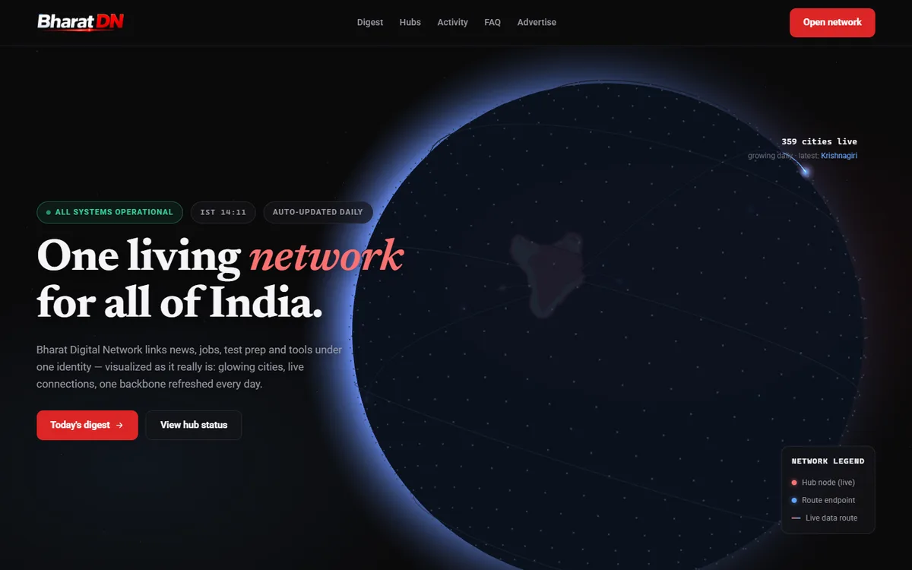
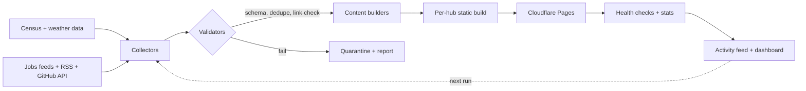
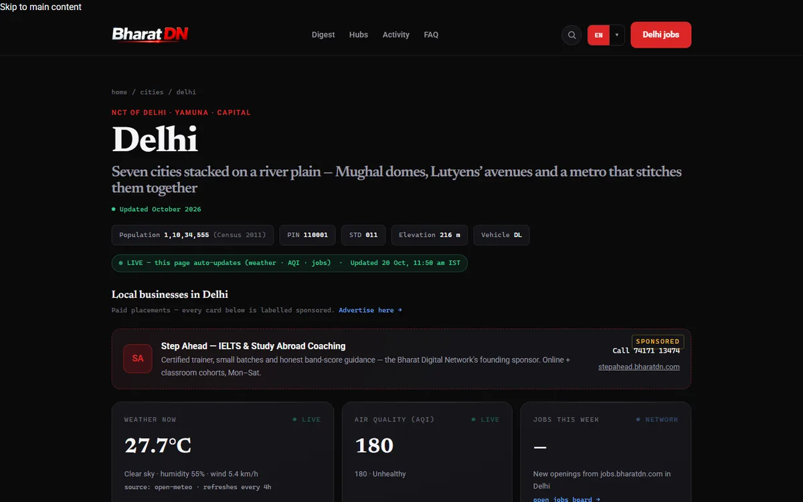
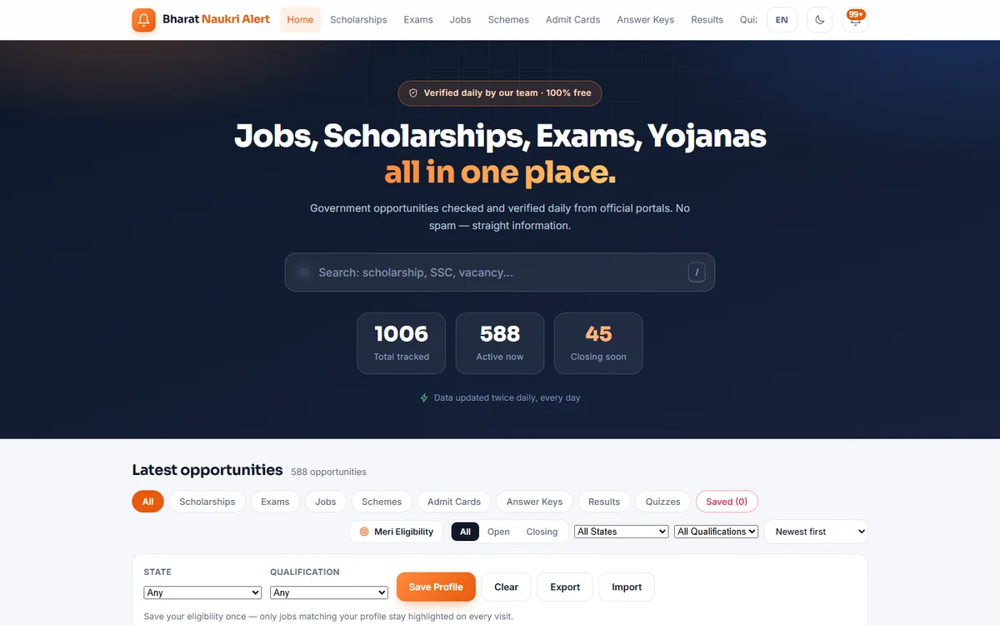
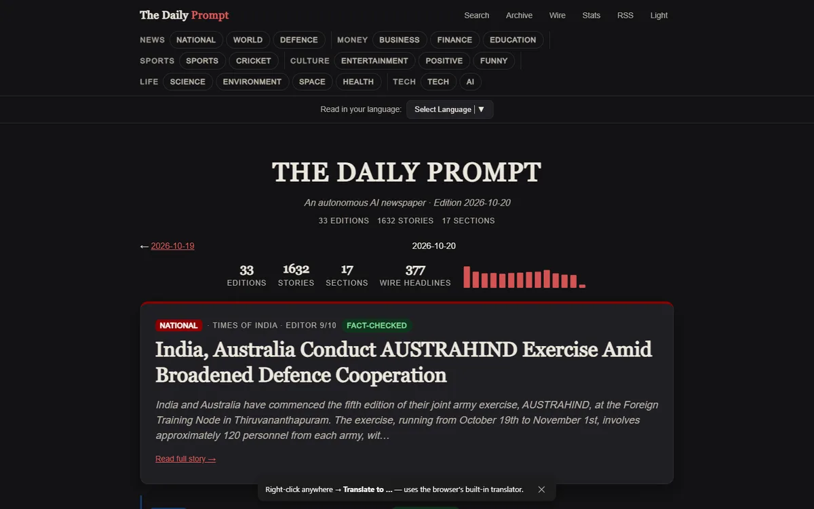
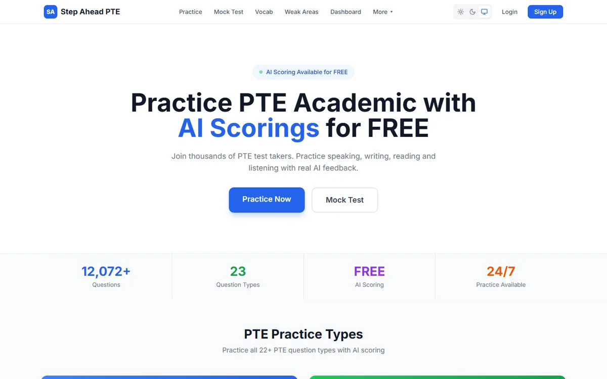
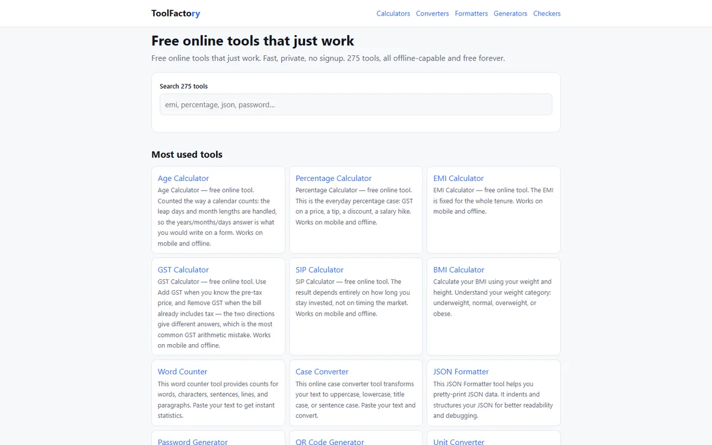

# Bharat Digital Network - architecture case study

**14 live properties. 330+ city guides. 275+ tools. One pipeline. Built solo in about four months.**

**Connecting India, city by city.**

This repository documents how [bharatdn.com](https://bharatdn.com) is put together.
The core code is private; this is the architecture, the decisions and the proof.

Live: [bharatdn.com](https://bharatdn.com) · Portfolio: [me.bharatdn.com](https://me.bharatdn.com)

---

## What it is

A network of education, language, jobs and utility products sharing one data and
build pipeline:

| Property | What it does |
|---|---|
| [bharatdn.com](https://bharatdn.com) | Network index, 330+ city guides, stats and activity feed |
| [ielts.bharatdn.com](https://ielts.bharatdn.com) | Computer-delivered IELTS practice |
| [pte.bharatdn.com](https://pte.bharatdn.com) | PTE practice with AI scoring and progress tracking |
| [french](https://french.bharatdn.com) · [german](https://german.bharatdn.com) · [spanish](https://spanish.bharatdn.com) · [japanese](https://japanese.bharatdn.com) · [korean](https://korean.bharatdn.com) · [mandarin](https://mandarin.bharatdn.com) | Six language hubs (A1-B1 / JLPT N5-N1) |
| [grammar.bharatdn.com](https://grammar.bharatdn.com) | English grammar, basics to exam standard |
| [jobs.bharatdn.com](https://jobs.bharatdn.com) | Government jobs, scholarships and exams - verified twice daily |
| [news.bharatdn.com](https://news.bharatdn.com) | The Daily Prompt - autonomous AI newspaper with a fact gate |
| [tools.bharatdn.com](https://tools.bharatdn.com) | ToolFactory - 275+ browser tools, no signup, no server |
| [stepahead.bharatdn.com](https://stepahead.bharatdn.com) | Step Ahead Institute - IELTS coaching |

## Architecture

### One pipeline, many products

Every hub is configuration, not a separate codebase:

- shared collectors with per-source adapters
- shared validation and retry rules
- shared HTML templates with per-hub sections
- one deploy step per run

Adding a language hub means adding a config file and content, not forking the
pipeline.

### Validation before publish

A build only ships if the data passes:

1. **Schema** - required fields, types, ranges.
2. **Dedupe** - canonical URL + content hash.
3. **Link check** - dead or redirected sources are dropped.
4. **Freshness** - stale records are marked, not silently published.
5. **Fact gate** (news) - claims must trace back to a source before publishing.

Failures go to a quarantine report instead of taking the whole run down.

### Jobs, twice daily

The jobs tracker collects listings, normalises them, checks the source link,
then republishes. At the time of writing: **1,006 tracked, 588 active**. The
number changes by design - the pipeline is the product.

## Programmatic SEO rules

330+ city guides only work if each page deserves to exist:

- real data per city (population, district, state, weather, local links)
- a published [methodology](https://bharatdn.com/methodology)
- internal linking from the index and neighbouring cities
- canonical URLs, sitemap, schema
- no thin pages: if there is no data, the page is not generated

The goal is not "more pages". It is **pages that answer a query better than a
generic listicle**.

## AI in production

The newsroom uses LLMs to draft, but not to decide:

- generation is constrained by source material
- a separate fact gate checks each claim against sources
- failures are rejected, not softened
- publishing is scheduled and idempotent

The PTE platform uses AI scoring with output constraints, caching and fallback
rules so the same answer does not swing wildly between attempts.

## Performance decisions

- plain HTML for content; JavaScript only where it earns its place
- 3D network view caps pixel ratio, pauses off-screen, respects reduced motion
- images are WebP with explicit dimensions
- static hosting + CDN; no server round-trip for reading
- one stylesheet, no framework, no trackers

## Screenshots

| Network index | City guide |
|---|---|
|  |  |

| Jobs tracker | AI newsroom |
|---|---|
|  |  |

| PTE practice | ToolFactory |
|---|---|
|  |  |

## Stack

`Python` `GitHub Actions` `REST APIs` `Cloudflare Pages` `Cloudflare DNS`
`HTML/CSS` `JavaScript` `LLM APIs` `programmatic SEO`

## What I would improve next

- move heavy collectors to a queue with per-source retries
- add real usage analytics and prune pages with no demand
- calibrate AI scores against human-rated samples
- add integration tests for every validator
- publish a public status page per hub

## Note

This is a case study, not the product source. The private core stays private;
everything above is verifiable at the live links.
